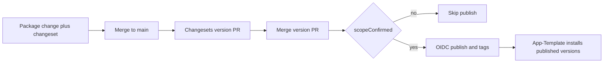

# App-Framework foundation

The repo is an empty GitHub project (`daniel-clain/App-Framework` on `main`, only [`.gitignore`](.gitignore)). Build the smallest working library platform. Do not add a Next.js app, a starter, or any catalogue feature beyond the two packages below.

Local machine has Node v25.9.0 (EOL) and npm 11.12.1. Corepack and pnpm are not installed. CI and [`.nvmrc`](.nvmrc) pin **Node 24** (current LTS line, v24.22.1). `engines` allows `>=22` so Node 22, 24, and this machine can run the packages. Pin **pnpm 12.15.0** in `packageManager` and install it with npm during implementation.

## Scope gate

Single source of truth: [`framework.scope.json`](framework.scope.json).

```json
{
  "npmScope": "@app-framework",
  "scopeConfirmed": false
}
```

Package names are `@app-framework/app-config` and `@app-framework/dev-tools`. A test fails if those names drift from the manifest. Both packages stay `"private": true`. The release job logs a skip and exits 0 while `scopeConfirmed` is false, so merging to `main` cannot publish. No `NPM_TOKEN` is added.

## Repository layout

```text
packages/config/          @app-framework/app-config
packages/dev-tools/       @app-framework/dev-tools
docs/architecture.md
docs/capability-catalogue.md
docs/consumer-contract.md
.changeset/config.json
.github/workflows/ci.yml
.github/workflows/release.yml
AGENTS.md
README.md
framework.scope.json
pnpm-workspace.yaml
```

Root scripts: `typecheck`, `lint`, `test`, `build`, `test:artifacts`, and `check` (runs them in that order). ESM, TypeScript strict, `NodeNext`. ESLint 9 flat config with typescript-eslint. Vitest. No Prettier, no bundler, no extra packages.

Changesets is independent: `fixed: []`, `linked: []`, `updateInternalDependencies: "patch"`, `baseBranch: "main"`, `commit: false`, `access: "restricted"`. The two packages do not depend on each other, so a change to one does not version the other. `updateInternalDependencies` still bumps a real dependent when one exists; a test proves that with `@changesets/assemble-release-plan` on a fixture where package B depends on A and C does not.



## Package 1: configuration

[`packages/config`](packages/config) has no runtime dependencies. Public entry is only `"."` pointing at `dist`.

API in [`packages/config/src/index.ts`](packages/config/src/index.ts):

- `defineConfig({ server, public })` accepts fields of kind `string`, `number`, `boolean`, `url`, and `enum`. A key cannot appear in both sections. A field is required unless it has a `default`.
- `loadConfig(definition, env, options)` reads a plain record (default `process.env`). Empty strings are missing. It returns `{ server, public }` with parsed values, or throws `ConfigError` listing every problem: key, visibility, and message.
- `loadPublicConfig` returns only public values and never reads server keys.
- `loadConfig` with `runtime: "browser"` throws before returning secrets, and the error text does not include secret values.
- Booleans accept `true`/`false`/`1`/`0`. Numbers reject non-numeric text. URLs use the URL parser. Enums require a listed value.

This is the whole capability. No dependency-injection container, secrets manager, or remote config service.

## Package 2: development tools

[`packages/dev-tools`](packages/dev-tools) depends on `semver` only. Binary `framework-check` (shebang, built to `dist/cli.js`). Library function `checkFrameworkPackages` is what tests call; the CLI only parses args, prints lines, and sets the exit code.

Behaviour:

- Read the consumer `package.json` dependencies, devDependencies, and optionalDependencies. Keep names under the scope of this package (`@app-framework/`), plus names listed in `appFramework.required`. Ignore every other dependency.
- Installed version comes from `node_modules/<name>/package.json`, not from the requested range. Missing installs are reported.
- `GET {registry}/{name}` with a default 5s timeout. Latest stable is `dist-tags.latest` when it is not a prerelease; otherwise the highest non-prerelease version.
- Same major and newer: one warning, `compatible update`. Higher major: a distinct warning, `major update`. Current or ahead: no line.
- Required name absent from the manifest or not installed: one warning. Do not edit any manifest or lockfile.
- Cache successful registry results under `node_modules/.cache/framework-check.json` for 12 hours. Flags: `--cwd`, `--timeout`, `--cache-path`, `--cache-ttl`, `--registry`, `--no-cache`.
- Registry timeout or network error: if cache exists, use it and print one warning; otherwise print one warning and continue. Exit code is always 0 for warnings and registry failure. Exit 1 only for unreadable local input.
- Success with nothing to report prints nothing, so App-Template can prefix `dev` with it.

Tests use a temp consumer fixture and an injected `fetch`. No live registry.

## Docs

[`docs/architecture.md`](docs/architecture.md): mission, package boundaries, explicit dependencies, release flow, and what stays out of this repo (App-Template, generated apps, Next.js landing pages).

[`docs/consumer-contract.md`](docs/consumer-contract.md): how App-Template installs the published packages, adds `"framework:check": "framework-check"` and runs it at the start of `dev`, declares `appFramework.required`, and calls `defineConfig` / `loadConfig` / `loadPublicConfig`. State that App-Template must not depend on this git repo, redefine these modules, or send application-specific code here. Include the pre-publish note that installs wait until the scope is confirmed and versions are on npm.

[`docs/capability-catalogue.md`](docs/capability-catalogue.md): all 121 groups, unchanged, under the seven domains. Each domain gets a short description and example implementation forms (package, standard, template, adapter, integration, policy). Each group gets:

- **Core standard**, **Optional capability**, or **Policy assessment**
- Status **implemented**, **planned**, or **deferred**

Rules used for every group:

- Policy assessment: legal, regulatory, jurisdictional, or business-policy decisions (the legal domain, plus age assurance and identity verification).
- Optional capability: a normal app can ship without it (payments, realtime, AI, content/marketing surfaces, internal operational UI, offline sync, analytics products, and similar).
- Core standard: everything else a production app of this platform needs.
- Implemented only for **dependency updates**, delivered by `@app-framework/dev-tools` as detection and reporting. It does not apply upgrades.
- Core standards that are not implemented are **planned**. Optional capabilities and policy assessments are **deferred**.
- `app-config` is named as existing foundation under type and API contracts and under secrets, without marking those broader groups implemented.
- Template-owned work (project bootstrap, landing page, hosting and deployment configuration) stays deferred and is labelled as an App-Template concern.

[`AGENTS.md`](AGENTS.md) stays short: mission, the two package boundaries, the App-Template relationship, the decision test for a new request (package, standard or policy, adapter, template concern, or application code that does not belong here), and links to the architecture and catalogue docs. It does not copy the 121 requirements.

[`README.md`](README.md): what the repo is, how to run `pnpm check`, how changesets releases work, and the manual setup still required before the first npm publish.

## CI and release

[`.github/workflows/ci.yml`](.github/workflows/ci.yml): on push and pull request, checkout, pnpm from `packageManager`, Node 24, `pnpm install --frozen-lockfile`, then `pnpm check`.

[`.github/workflows/release.yml`](.github/workflows/release.yml): on push to `main`, `changesets/action` opens or updates the version PR. Publish step builds, then runs a script that returns without publishing while `scopeConfirmed` is false. Workflow permissions: `contents: write`, `pull-requests: write`, `id-token: write`. Do not set `NPM_TOKEN` or `NODE_AUTH_TOKEN`. `setup-node` uses `registry-url: https://registry.npmjs.org` and does not cache the package manager on this job. npm CLI on the runner must be 11.5.1 or newer (trusted publishing). Provenance is automatic once OIDC publishing is used.

Document this one-time setup in the README; do not perform it:

1. Confirm the npm scope is owned and available. Update `framework.scope.json` and both package names together if it is not `@app-framework`.
2. Set `scopeConfirmed` to true, set both packages `"private": false`, and set Changesets `access` to `public`.
3. Publish each package once from a logged-in machine. Trusted publishing cannot create the first version.
4. On npm, for each package, add a GitHub Actions trusted publisher: user `daniel-clain`, repository `App-Framework`, workflow filename `release.yml`, and allow `npm publish`. New publisher configs must complete a successful publish within the window npm currently enforces (2 days).
5. After that, merging a version PR publishes only changed packages and their dependents, and creates package tags. Consumers are not updated automatically.

Initial package version is `0.1.0` with a changelog entry. No changeset file is committed for that initial version, so the first push does not open a version PR.

## Verification

Install pnpm 12.15.0, then `pnpm install` and `pnpm check`. Tests cover:

- Public exports and the single export map; packages import independently and do not depend on each other.
- Config success, aggregated missing and invalid values, defaults, server values absent from public results, and browser runtime refusing secrets.
- CLI: outdated compatible upgrade, distinct major upgrade, ignored third-party deps, missing required package, timeout and network failure exiting 0, cache reuse.
- Changeset release plan: an A-only change versions A and dependent B, not unrelated C; a dev-tools-only change does not version app-config in the real graph.
- After build: `dist` JavaScript and `.d.ts` match `exports`, the CLI bin exists, and `npm pack --dry-run` includes `dist` and excludes tests and source.

No app UI, so browser verification does not apply. No git commit unless you ask.